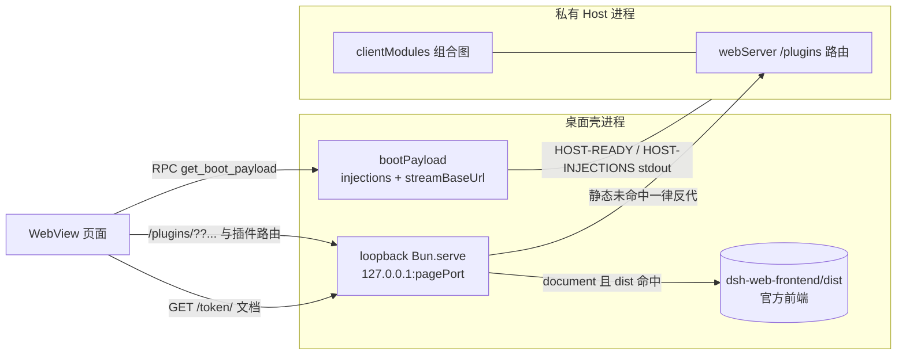

# 桌面壳的 DSH 静态资源与插件 client 资产：现状、为什么插件 UI 仍走 Host，以及「本地直出」的可行边界

- 日期：2026-10-18
- 仓库：`dsh-desktop-bun`（壳基线 `747f986`）
- 对照上游：`/Users/mutou/vault/projects/deepseek-harness`（`0.2.1-rc.2`，与已装运行时 `.../app/dsh/node_modules/@deepseek-ai/dsh/package.json` 同版本）
- 性质：只读调研（壳源码 + 上游源码 + 本机 profile 实测）；无代码改动
- 问题：壳目前是否只本地加载 DSH 官方内容？插件改 UI 后资源是否仍走 Host？能否让第三方插件的 client 资产全部从 `<profile>/node_modules` 本地出，做到「只有数据走 Host」？

## 结论

1. **现状：本地只出「官方前端 dist」这一层。** 壳的 loopback 服务只对 `document` 类请求做 dist 磁盘命中（`shell-server.ts` 的 `serveStatic` 仅在 `decision.kind === 'document'` 时调用），其余路径（壳自答的 `/__shell__/*` 除外）——`/plugins/*`、插件自带路由（如 `/smooth-stream/*`、`/dsh-ui-progress/*`）、`/api/*`、WS/SSE——一律 `proxy()` 给 Host。插件 UI 的产物（`dsh.client` bundle）与**壳自己的桌面插件** `dsh-desktop-bun/lib/client.js` 都在 Host 侧出字节。
2. **这不是本仓的偷懒取舍。** 官方 Electron 桌面（`apps/desktop/src/main.ts:667` 的 `protocol.handle`）也只本地出 `/`、`/index.html`、`/assets/*`、`/favicon.svg`、`/manifest.webmanifest`，其余（含 `/plugins/*`）走 `forwardWebRequest()` 交给私有 Host；`web-document.ts` 里 `PLUGIN_BUNDLE_PATH = /^\/plugins\//` 还专门把这些响应改回 `no-store`。两个壳是同一套分层。
3. **文件层面「从 profile 出」成立，但当前 `/plugins` 不是文件路由，而是 Host 组合出来的「组合脚本路由」。** URL 形如 `/plugins/??pkgA/client.js,pkgB/client.js&rev=<12位hex>`，由 Host 的 Cordis Loader 图生成；响应是 Host **内存里**拼好的多包拼接（还带合成 Indexed Source Map、rev 校验、stale rev ⇒ 404）。壳直接把 `node_modules` 里的文件吐出去，得到的不是同一个响应。
4. **上游确实预留了「壳持有载体」的接缝，但它不解决「Host 不参与」。** `ctx.clientModules.fetchBundle(request)` 的注释是「Serve an advertised revisioned bundle or source map **without a Web server**」「shell-carrier request for a `/plugins` resource」——调用发生在 Host 进程内，字节仍从 Host 内存出。它解决的是「壳没有 webServer 时怎么把同一份响应交给页面」，不是「壳直接读盘」。
5. **严格意义的「只有数据从 Host 拿」需要上游再让一步**：把「图 + 每个条目的包绝对路径 + rev」暴露到 Host 进程外（或用 IPC 把这几个值交给壳），并把 artifact 组合（拼接 / map / rev 校验）抽成无状态、可跨进程复用的纯函数。否则壳只能自研复刻：上游 Node 半是 **1184 行**（`packages/client/modules/src/index.ts`），行为由 **2855 行**单测（`packages/client/modules/tests/`）锁住，还要跟上游每个 rc 的 wire 演进。
6. **收益主要在架构与安全，不在性能。** Host 的组合体在组合时就把 `client.js` 读成 `Buffer`（`WebPluginRecord.bundle: Buffer`），请求命中是内存操作；壳改成读盘通常持平或更慢。而且即使做到「本地出字节」，**加载清单仍必须来自 Host**（哪些插件启用、组合顺序、rev、release 都由 Host 的 Loader 决定）。所以「完全前后分离」在可预见形态里只能是「**清单/图来自 Host，字节本地出**」。

## 1. 现状：一次页面启动拿了哪些资源

### 1.1 文档与官方 dist：本地

- 页面 URL 是 `http://127.0.0.1:<pagePort>/<token>/`（`service.ts` 的 `pageUrl`），准入按「token 路径前缀」判 `document`（`shared/admission.ts` 的 `decide`）。
- `document` 命中后先查 dist：`resolveAsset(distDir, rel)`，命中出磁盘文件；`index.html` 额外注入 `__DSH_BOOT_READY__` 一行（`shell-server.ts` 的 `injectBoot`）。dist 由 `runtime.ts` 的 `runtimePathsOf` 定位到运行时的 `@deepseek-ai/dsh-web-frontend/dist`（可用 `DSH_SHELL_DIST` 覆盖）。
- 这里出的就是**官方前端**（Vite shell：`assets/*`、favicon、manifest），没有插件代码。

### 1.2 boot 载荷：来自 Host 的注入行

- Host 就绪时通过 stdout 报 `HOST-READY {url, injections}`（`bun/host.ts`；对齐官方 `apps/desktop/src/host-process.ts`，官方走 Node IPC，`apps/desktop-host/src/index.ts:104` 发 `{type:'ready', url, injections: ctx.webServer.collectIndexInjections()}`）。
- 注入行里包含模块系统的 queue facade、application 批量 preload、bootstrap 组合脚本，以及 `window.__DSH_BOOT__` 图本身（`bootInjections(graph)`）。其中脚本 URL 是**文档相对**的（`comboReference()` 去掉前导 `/`）。
- 壳不解析这些行，原样存进 `bootPayload`，页面经 RPC `get_boot_payload` 取回后自己 `applyIndexInjections`，于是 `<script src="plugins/??...">` 在页面里发出——相对当前文档，最终落到 `/<token>/plugins/...`（`policy.test.ts` 有这条断言）。Host 运行期图重算时再来一条 `HOST-INJECTIONS`，壳只换载荷（`#101`）。

### 1.3 插件资产：走 Host

- 静态查找只对 `document` 做；`/<token>/plugins/...` 虽然也是 `document` 类，但 dist 里没有 `plugins/` 目录 ⇒ 未命中 ⇒ `proxy(request, decision.stripped, url.search)`。根绝对路径 `/plugins/...` 直接进数据面反代。两条形状都存在：`asset-path.ts` 的注释记录了 `/<token>/plugins/??…` 与插件自带路由；`admission.ts` 记录了页面发出的 RPC/SSE/插件资产也可能是根绝对路径（#219 实测）。
- 反代对 `/plugins/*` 与 `/api/*` 强制 `no-store`（`shared/headers.ts` 的 `shouldNoStore`），与官方 `web-document.ts` 同款。
- 反代是流式、带单飞合并（`coalescing.ts`）与 SSE 不设 idleTimeout（#159）。
- 壳还会把 **`.map` 结尾的请求提前 204**（`shared/asset-path.ts` 的 `isNoContentAsset`，`shell-server.ts` 在静态 miss 后调用）：chunk 的 map（`…/client.<name>.js.map?rev=`）因此拿不到；combo 的 map 把 `.map` 放在 query 里（pathname 仍是 `/plugins/`），照常反代。开发态看不到 chunk 源映射是现状的一部分。

| 请求 | 谁生成 | 谁出字节 | 现在怎么走 |
| --- | --- | --- | --- |
| `/<token>/`、`/assets/*`、favicon/manifest | 官方 dist | 壳本地磁盘 | `serveStatic` |
| `/<token>/plugins/??a/client.js,b/client.js&rev=` | Host 组合图 | Host 内存（组合体） | `proxy` |
| `/plugins/<pkg>/client.<name>.js?rev=`（chunk） | Host 组合图 | Host 惰性读盘并缓存 | `proxy` |
| `/plugins/events`（SSE 图/重建帧） | Host HMR | Host 进程 | `proxy` |
| 插件自带路由（`/smooth-stream/*` 等） | 插件服务端 | Host 进程 | `proxy` |
| `/api/*`、`/api/remote.mux`（WS） | Host | Host | `proxy` / WS 隧道 |

## 2. Host 侧 `/plugins` 到底是什么

证据集中在 `packages/client/modules/src/index.ts`（Node 半）：

- **路由**：只在 `webServer` 注入时注册 `{ kind: 'prefix', path: '/plugins', handler: this.serveBundle }`（`registerWebCarrier`）。也就是说 `/plugins` 是 Host 的 web carrier 的一部分，不是文件目录。
- **URL 形态**：组合 `comboSearch(ids, rev)` 生成 `??a/client.js,b/client.js&rev=<12hex>`；包内 chunk 是 `chunkUrl(id, fileName, rev)`，文件名还必须匹配 `CLIENT_CHUNK` 并显式排除 `client.node.*`（那是 Node 侧导出，`packages/client/modules/src/index.ts:1116`）；source map 用同一组合查串加 `.map`，脚本尾部追加 `//# sourceMappingURL=??…`（约 80 字节尾巴）——本仓 `mobile/dsh-mobile-nav/docs` 里有 0.1.5/0.1.2 的实测对账（served body = `lib/client.js` 逐字节前缀 + 80 字节尾巴，rev 与 sha1 无关）。
- **字节来源**：组合时每个条目的 bundle 已被读进 `WebPluginRecord.bundle: Buffer`；响应体首次 `GET` 时拼接并缓存（`responses` / `batchResponses`，另有 `previousBatchResponses` 覆盖 HMR 换代竞态）。单个条目的路径由 `clientPath(id)` 给出，来自 `locatePkgJson`：用 `ctx.loader.internal.resolveSync` 按**该条目自己的 Loader specifier 与 baseUrl** 解析，取最近的 `package.json`，再读 `exports["./client"]`。
- **rev 与 allowlist**：`artifactRevision` = `framedHash('plugin-artifact', [mtimeMs, ctimeMs, size])` 的前 12 位；只有被组合图广告过的 URL 才有响应，未知/过期 rev 一律 404（不会“回退成当前文件”）。这既防缓存串字节，也等于一张**启用集合的 allowlist**。
- **组合粒度**：一个 combo 是一个 `<script>`，按顺序注册多个 factory；`PARSER_PRELOAD_IDS` 把 bootstrap 单独切出，其余按阶段分批，URL 超过 3 KiB（`MAX_COMBO_URL_BYTES`）就切下一批。**不能按包拆开本地出**——拆了页面拿到的 factory 注册序列就变了。
- **HMR**：`/plugins/events`（`packages/client/hmr/src/events.ts` 的 `EVENTS_ENDPOINT`）推图与重建帧；`rebuilt(id)` 是 bundle 变化进入图的唯一入口，`onGraphChanged` 是拉模型。HMR 的制品监视是 **500ms 的 `stat` 轮询**（`packages/client/hmr/src/index.ts:31-36`，设计上兼容网络挂载），不是 inotify；release 身份（`version` + 构建期烧入的 `commit`）决定页面是否接受某个图。

## 3. 官方桌面：同一套分层

`apps/desktop/src/main.ts:667` 的 `protocol.handle(SCHEME, …)`：

- `dsh-app://shell/*`：应用自带文档，本地出；
- `dsh-app://app/` 的 `/`、`/index.html`、`/assets/*`、`/favicon.svg`、`/manifest.webmanifest`：从 `resources.dsh/node_modules/@deepseek-ai/dsh-web-frontend/dist` 本地出；
- 其余（包括 `/plugins/*`）：`forwardWebRequest(request, hostUrl, hostCookie)`，并给 `/plugins/*` 强制 `no-store`。

`web-document.ts` 的 `forwardWebRequest` 与壳的 `proxy()` 是同一件事（剥 `host/origin/cookie/sec-fetch-site`、塞 Host cookie、剥连接级响应头）。官方也一样把插件 bundle 交给 Host。

## 4. 本地化可行性

### 4.1 字节确实在本地（实测）

- `~/.dsh/profiles/desktop/node_modules` 有 319 个条目（含 scoped 目录），第三方插件就在里面，例如 `billion-context/package.json` 的 `dsh.client.platform = 'web'`、`exports["./client"] = ./dist/agent/dsh-native-client.js`。
- 壳自己的桌面插件是 `~/.dsh/profiles/desktop/node_modules/dsh-desktop-bun -> <app>/Contents/Resources/plugins/dsh-desktop-bun`（`plugin-staging.ts` 的 symlink 池），`exports["./client"] = ./lib/client.js`；`desktop-plugin/scripts/build-client.mjs` 的注释明说“浏览器端由 dsh web 以 `/plugins/dsh-desktop-bun/client.js` 加载”。
- 官方插件在运行时树 `.../dsh/node_modules/@deepseek-ai/*`（同样带 `dsh.client`）。
- 另有共享池 `~/.dsh/profiles/node_modules`（263 项），是依赖 hoist 池，不改变结论。

所以「字节在本地」没有问题；问题在**响应语义**。

### 4.2 七个硬约束

1. **URL 是组合式 + rev 校验**：不是 `/plugins/<pkg>/<file>` 这种文件路由；壳要复刻的是 `??a,b&rev=` 的解析、顺序、拼接、尾部 map 引用。
2. **包解析在 Host 的 Loader 里**：`resolveSync`（含 ESM hooks、`baseUrl`、最近 manifest、符号链接、scoped 包、同名多副本的冲突判定）；profile 侧还有「安装锚点优先、再 profile 目录」的双锚点与 pnpm 符号链接 / realpath 双拼写（`packages/boot/app-boot/src/profile.ts` 的 `resolveBundleDir`）。壳只能用 Node 解析做近似；挑到另一个副本就是另一份字节。
3. **source map 要合成**：combo 的 map 是 Indexed Source Map v3，缺 authored map 时生成 identity section（`identitySectionMap`）；壳不复刻就只能 204/坏 map（devtools 报错）。
4. **启用集合是 allowlist**：Host 只服务图里广告过的 URL。壳若按“文件存在就出”，会变成“任意已装插件的 bundle 都能被猜 URL 拉到”，等于放宽了启用边界与 404 语义。
5. **HMR / release 只能在 Host**：`/plugins/events`、`rebuilt()`、`release` 身份、`onGraphChanged` 都绑定 Host 的 Loader 生命周期；壳本地出字节仍需接这条流，否则实时装卸/重建失效。
6. **插件自带路由不是文件**：`/smooth-stream/*`、`/dsh-mnemon-settings/*`、`/dsh-ui-progress/*` 是插件服务端逻辑（有的按请求生成 UI/CSS/JS），永远属于数据面；「所有 client 侧资源都本地出」最多覆盖 dist + `dsh.client` bundle。
7. **远端模式例外**：`service.ts` 的 `connect()` 里 `remoteAddr !== null` 时「不 spawn 宿主，数据面指向远程」，页面文档仍由本机 dist 出；此时 `/plugins` 必须来自远端，本地 profile 里根本没有那些插件。本地化只能对“本地 Host + 本地 profile”成立。

### 4.3 四条路线

| 路线 | 做法 | 字节从哪出 | 代价 | 判定 |
| --- | --- | --- | --- | --- |
| A 现状 | 壳反代 `/plugins` | Host 内存 | 无 | 已在用 |
| B 壳内缓存 | 按 `URL+rev` 缓存 combo 响应，命中本地出 | 首次 Host，之后壳 | 缓存失效/内存上限；仍不是“从 profile 出”；`no-store` 语义要重定义 | 只算优化，不算分离 |
| C 上游给接缝 + 壳读盘 | Host 经 IPC 给出「图 + 每行 `clientPath` + rev」，壳读文件、拼接、合成 map、按 rev 校验 | 壳本地磁盘 | 需要上游改协议（新增壳侧接口）；壳实现拼接/map/校验；跟随 wire 版本 | **推荐方向** |
| D 壳完全自研复刻 | 壳自己解析 profile/node_modules、复刻组合与 map | 壳本地磁盘 | 复刻 1184 行 + 2855 行测试锁住的行为；与上游 rc 演进强耦合；解析一致性风险 | 不建议 |

C 的关键不在“读文件”，而在**Host 把图交出来**：图决定加载哪些行、顺序、`inject/external`；`clientPath` 决定读哪个文件；`rev` 决定是否允许这次请求。三者缺一，本地出字节就会和页面预期错位。

### 4.4 上游已有的接缝与缺口

- 已有：`ctx.clientModules` 的 `graph()` / `clientPath(id)` / `fetchBundle(request)` / `rebuilt(id)` / `onRebuilt` / `onGraphChanged`（`docs/subsystems/client-modules.md` 的服务目录），以及 `fetchBundle` 的 “without a Web server / shell-carrier request” 注释。这证明上游**认可**“壳持有载体、Host 只供响应”的形态。
- 缺口：`fetchBundle` 仍要求请求进 Host 进程；上游没有把「包绝对路径 + rev」跨进程交给壳的接口，也没有把 artifact 组合抽成可复用的纯函数包。壳要“本地出”，这两样至少要有一样（最好是组合逻辑做成上游包，壳只负责读盘与路由）。补充事实：当前打包壳**一次都没调用过 `fetchBundle`**（`app/bun/index.js` 零命中），纯反代——这条「壳自持载体」的接缝连参考实现都还没有。
- 另一个方向是让 Host 侧“静态资产也按 URL 直接从磁盘出”（壳只反代）：那仍是 Host 出字节，不满足题设。

## 5. 收益与代价

- **性能：不成立。** Host 组合时已把 bundle 读进 `Buffer`，`/plugins` 命中是内存 + Map 查找；壳改读盘（`Bun.file`/`readFile`）一般持平或更慢。loopback 一跳在毫秒级以下，且已有单飞合并与流式反代。真正的冷路径（Host 刚起、浏览器首次拉）也不会因为本地出而变快——文件本来就在本地。
- **安全：双向。** 正面：Host 不再承担“按包根读文件”的静态服务面。负面：如果壳按文件存在性服务，会把 Host 的 allowlist 语义（只服务图里的 URL、stale rev 404）退化成“任意已装包可拉”，这是**放宽**。
- **可用性：收益有限。** Host 重启时静态与插件 UI 能继续加载，但数据面 `/api` 仍断，壳本来也会 `reloadWindow(state.pageUrl)` 重载页面（`index.ts` 的 `onHostRestart`）。也就是说页面不会因为“资产本地”而多活。
- **可维护性：成本最高的一项。** wire 由上游单方面演进（combo 查串、map 合成、rev 算法、3 KiB 分区、release 语义），壳复刻的任何一处漂移都是“页面白屏/插件不加载”级故障；本仓已有 #219（前缀白名单漏掉插件路由）这类前车之鉴。
- **架构：唯一确定的收益。** “host 只做数据”确实是更干净的分层；但它要求上游把资产面显式设计成可外置的（C 路线），而不是壳单方面搬运。

## 6. 建议

1. **短期（本仓可做）**：不动分层，补齐现状的观测与边界——`/plugins` 反代已有 no-store、SSE 不设 idleTimeout、单飞合并；可加“combo 响应缓存（按 `URL+rev`，LRU，`no-store` 语义保持）”作为可选优化，但它不是前后分离，别按分离宣传。
2. **中期（上游接缝）**：向上游提「shell-owned carrier 的资产本地化」：Host 通过 IPC 暴露 `graph()` + 每行 `clientPath()` + rev（或一个 `assetsManifest()`），并把 combo 拼接/Indexed map/rev 校验抽成 `@deepseek-ai/dsh-client-module-artifacts` 一类的纯函数包；壳只做“读文件 + 组合 + 校验 + 返回”。这样第三方插件 bundle 才真正从 profile 出，且不需要壳复刻语义。
3. **明确边界**：即使做到 C，`/plugins/events`、插件自带路由、`/api/*`、`/api/remote.mux` 仍必须走 Host；「只有数据从 Host 拿」应表述为「**清单/图与数据从 Host 拿，dist 与 `dsh.client` 字节本地出**」。远端模式下资产必须仍来自远端。
4. **不建议**在本仓自研 D 路线：成本与漂移风险远大于收益，且会与上游 release/revision 语义打架。

## 复核口径

- 主文引用上游源码仓（`0.2.1-rc.2`，`687f282e86`）；另用本机打包运行时的构建产物（`/Applications/DeepSeek Harness Desktop BUN.app/Contents/Resources/app/dsh/node_modules/@deepseek-ai/dsh-client-modules/lib/index.js` 等）逐条复核并交叉验证，结论一致。构建产物行号随构建漂移，故正文只标源码仓路径。
- 复核增补的确定性事实：`webServer` 路由匹配 exact 先于最长前缀（`/plugins/events` 不会被 `/plugins` 前缀吃掉）；`HOST-INJECTIONS` 由宿主每秒重采集、按 JSON 差异补发；页面侧 `applyIndexInjections` 在 `packages/client/web/src/apply-injections.ts:18`（壳只插 `BOOT_LINE`，rows 由页面自己应用——完整 boot graph 本就在注入行里，壳只是不解析）；release 的 `commit` 是构建期常量。

## 证据清单

- 壳：`desktop-electrobun/src/bun/shell-server.ts`（`serveStatic` 仅 `document`、`proxy`、`injectBoot`、WS 隧道、`idleTimeout: 0`）、`desktop-electrobun/src/shared/asset-path.ts`（静态优先与插件路由）、`desktop-electrobun/src/shared/admission.ts`（token 前缀 vs 根绝对路径）、`desktop-electrobun/src/shared/headers.ts`（`shouldNoStore`）、`desktop-electrobun/src/bun/service.ts`（`pageUrl`、`bootPayload`、远程模式 `connect()`）、`desktop-electrobun/src/bun/host.ts`（`HOST-READY`/`HOST-INJECTIONS`）、`desktop-electrobun/src/bun/index.ts`（`onHostRestart` 重载）、`desktop-electrobun/test/policy.test.ts`（`/<token>/plugins/??…` 的 `document` 断言）。
- 上游：`apps/desktop/src/main.ts:667`（`protocol.handle` 白名单）、`apps/desktop/src/web-document.ts`（`forwardWebRequest`、`PLUGIN_BUNDLE_PATH`）、`apps/desktop/src/host-process.ts`、`apps/desktop-host/src/index.ts:104`（注入行上报）、`packages/client/modules/src/index.ts`（`PLUGIN_ROUTE`、`comboSearch`、`chunkUrl`、`artifactRevision`、`WebPluginRecord.bundle`、`locatePkgJson`、`registerWebCarrier`、`fetchBundle`）、`packages/client/modules/src/client/manifest.ts`（`WebBootGraph`/`WebBootEntry`）、`packages/client/hmr/src/events.ts:44`（`/plugins/events`）、`docs/subsystems/client-modules.md`、`packages/host/frontend-static/src/index.ts`。
- 本机实测：`~/.dsh/profiles/desktop/node_modules`（319 项）、`billion-context/package.json`（`dsh.client` + `exports["./client"]`）、`dsh-desktop-bun` 的 symlink 与 `lib/client.js`、`desktop-plugin/scripts/build-client.mjs` 的注释、`mobile/dsh-mobile-nav/docs` 的 combo/rev 对账记录。
